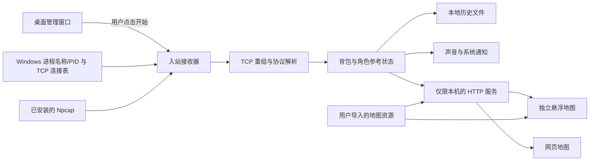

# 架构与运行边界

本项目由桌面管理入口、本机接收服务、状态与存储层，以及悬浮和网页地图组成。它展示本机收到的观测，不主动向游戏服务器查询背包状态。

## 数据流

管理窗口默认不开始接收。启动接收、停止接收、查看地图和导入资源是独立的用户操作。历史浏览不应隐式启动接收器。

## 模块职责

| 模块 | 职责 |
| --- | --- |
| `__main__.py` / `desktop.py` / `runtime.py` | 单 EXE 的桌面入口与运行管理，启动和管理本工具的接收服务、悬浮窗口与本地浏览入口。 |
| `collector.py` | 识别游戏连接，配置 Npcap 入站过滤，读取数据、处理连接变化与离线回放。 |
| `protocol.py` | TCP 字节流与消息边界处理、解压、事件解析；不执行第三方程序代码。 |
| `model.py` | 维护背包状态、去重、角色参考位置和提醒条件。 |
| `history_store.py` | 本地存档、迁移、写入互斥、原子保存及备份。 |
| `notify.py` | 声音与 Windows 通知。 |
| `app.py` | 本机 HTTP 状态与控制接口，以及静态网页资源。 |
| `overlay.py` / `overlay_text.py` | 独立悬浮地图、交互与多语言文本。 |
| `static/` | 不依赖外部 CDN 的网页地图和完整历史候选点。 |
| `resources.py` | 默认坐标网格，以及用户授权资源的本地导入与查找。 |
| `git_archive.py` | 可选的本地历史版本归档。依赖本机 Git，不自动推送。 |

## 接收与进程访问

接收器通过 Windows 进程快照取得名称与 PID，并从 TCP 连接表确定游戏拥有的连接。Npcap 使用这些连接的地址与端口构造精确入站过滤，接口以非混杂模式打开。

游戏进程不使用 `OpenProcess` 打开。实现不读取或写入游戏内存、不注入模块、不模拟游戏输入，也不调用 Npcap 的发包接口。Npcap 本身具有发包能力，不代表本项目使用该能力。

`git_archive.py` 中的 `OpenProcess(SYNCHRONIZE)` 是另一条用途明确的调用：归档子进程等待本工具自己的父进程退出。它请求同步权限，不请求游戏进程的内存权限。

实时原始包仅在解析路径中处理，默认不持久化原始抓包。开发者提供的离线抓包只用于显式回放测试，不应进入公开仓库或发布包。

## 状态的含义

| 状态 | 表示什么 |
| --- | --- |
| 收到记录 | 本机收到与红色背包类型匹配的对象与坐标；不证明它刚刷新。 |
| 有人交互 | 收到交互事件；不能仅凭此断言已经开启或是谁操作。 |
| 已开启 | 收到与已开启／耗尽状态对应的后续事件。 |
| 状态未知 | 缺少可继续确认状态的信息，例如断线、暂停、换图或对象离开接收范围。 |
| 即将刷新 | 基于历史更新时间计算的估计窗口；不是服务器确认的新刷新事件。 |

角色位置使用有来源约束的间歇参考坐标，最多保留 10 秒的新鲜度。过期参考可以保留在画面上，但不能继续报告实时距离或推算移动。

新目标会被选中并高亮。地图保留用户更近的缩放；局部目标视野约 240 米。开启跟随时保留角色参考中心，屏外目标使用相对于地图画面的边缘箭头。历史载入和会话初始化不会重放旧提醒。

## 本机通信和存储

HTTP 服务绑定回环地址，默认使用 `127.0.0.1:18726`。控制请求受本机来源检查与运行时控制令牌约束。令牌属于本次本机运行，不应提交到 Git、截图或公开日志。

个人数据使用 Windows 文档目录中的 `AION2-RedBag-Map/data/`。程序目录、公开观测数据和个人持续历史各自独立。资源导入位置是该数据目录下的 `assets/`。

运行时不配置遥测、远端更新检查、云同步或上传。可选 Git 归档只产生本地版本；连接远端或公开存档是另外的显式操作，不由本工具自动完成。

## 可验证范围

协议解析和状态转换可使用合成数据验证；网页视野、过期状态和提醒去重有独立测试。真实接收仍受游戏版本、连接路径、Npcap 安装权限和服务器实际下发范围影响。测试通过不能推出全图覆盖、官方接口兼容或反作弊认可。
